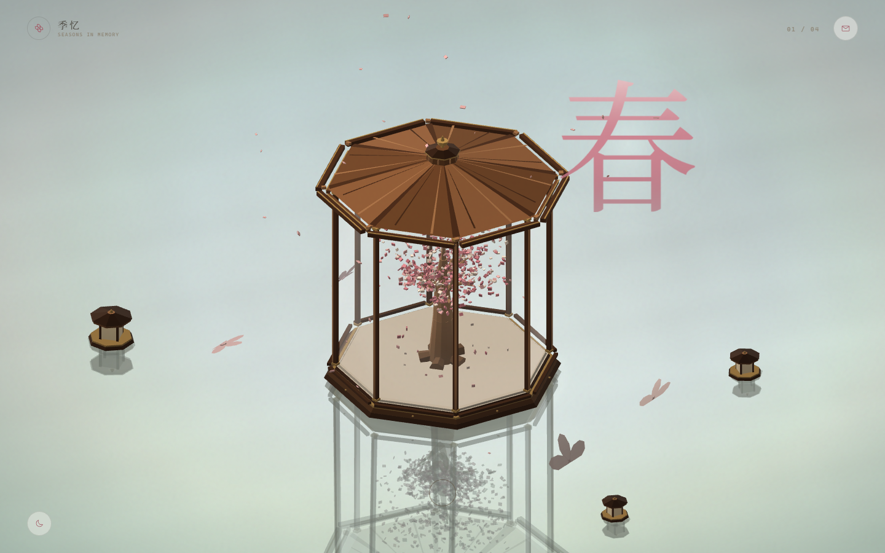
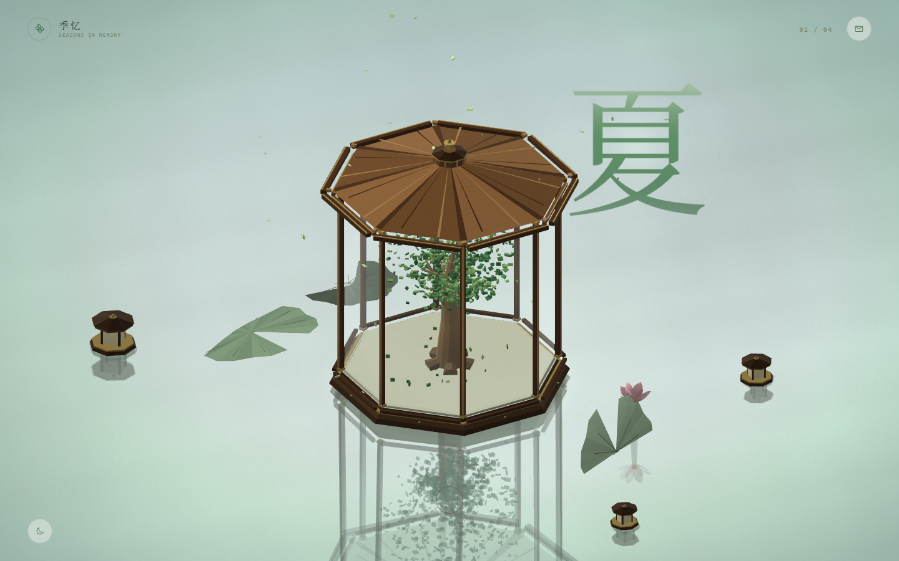
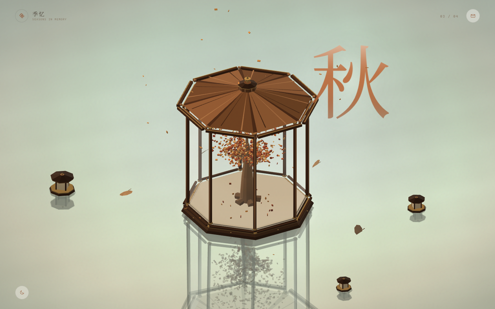
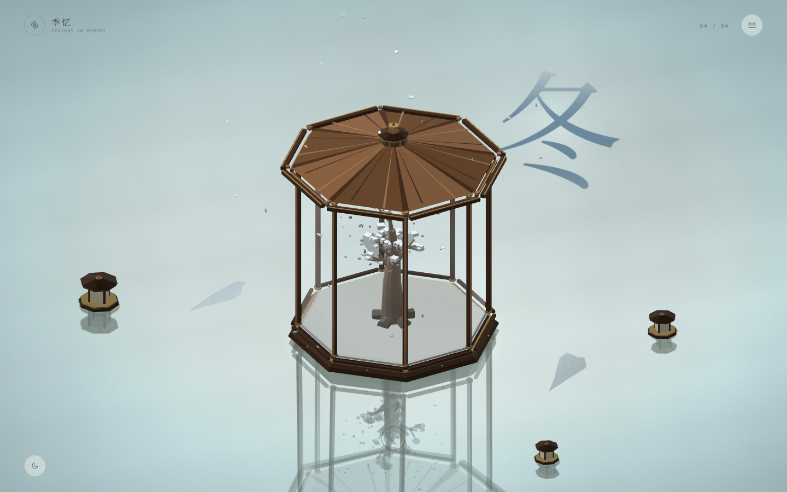
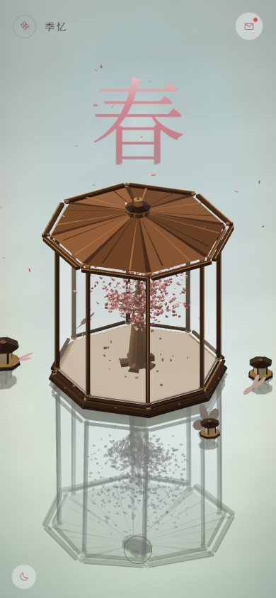

# 季忆 · Seasons in Memory

一盏漂在水上的八角灯笼。转动它，树会走完春、夏、秋、冬；每到一个季节，灯笼会轻轻往下一沉、刚好碰到水面，细小的同心涟漪从浮板边荡开，再慢慢变宽、变淡、散掉。**每转满一圈**，整顶玻璃罩会带着一点漂移和倾斜抬离水面，树开成一朵立体的花；继续转动，花收回、罩子落回。

水面有层叠的风纹、细毛细波、阵风斑块和流动高光；灯笼、树、三盏小水灯，以及随季节出现的浮花、圆荷叶与粉荷、落叶、薄冰都有倒影。夜里灯笼自己亮起来，周围有萤火，没有月亮。

主页面只有场景，没有左下角文字栏。季节落定后底部正中会出现空心圆点；点进去才是这一季的信页 (`letter.html?season=...`)。



<table>
  <tr>
    <td width="50%"></td>
    <td width="50%"></td>
  </tr>
  <tr>
    <td align="center">夏 · 荷叶与粉色荷花，夜里会亮</td>
    <td align="center">秋 · 不同大小/颜色的浮叶</td>
  </tr>
  <tr>
    <td></td>
    <td></td>
  </tr>
  <tr>
    <td align="center">冬 · 薄冰与落雪</td>
    <td align="center">手机版 · 季节字与空心圆点</td>
  </tr>
</table>


## 打开方式

直接双击 `index.html` 即可。没有构建步骤、没有第三方依赖、没有网络请求；灯罩、水面、树、花和季节元素都是运行时用代码画的，字形使用项目内的 84 kB 字体子集。

- 需要支持 WebGL2 的浏览器：Chrome / Edge / Safari 15+ / 微信内置浏览器（较新机型）。
- 如果在 `file://` 下指针事件受限，可以起一个静态服务器：

```powershell
python -m http.server 8080
npx serve .
```

然后访问 `http://localhost:8080/four-seasons/`。

## 发布到 GitHub Pages（分享到微信）

远程：`https://github.com/bt7rdrcfzf-eng/sea.git`；发布地址：`https://bt7rdrcfzf-eng.github.io/sea/`。

仓库已推送，GitHub Actions 会在 push 到 `main` 时自动部署。首次在仓库 **Settings → Pages** 里把 **Source** 设为 **GitHub Actions** 即可；之后每次 push 自动发布。微信里打开页面，右上角 `...` → **分享给朋友**。

微信卡片封面使用绝对地址：

```html
<meta property="og:image" content="https://bt7rdrcfzf-eng.github.io/sea/docs/share.jpg" />
```

## 交互

| 操作 | 效果 |
| --- | --- |
| 左右拖动 / 横向滚轮 | 旋转灯笼和树，四季连续过渡 |
| 松手 | 惯性滑行后吸附到最近的季节；灯笼下沉碰水，同心涟漪散开 |
| 点击底部正中的空心圆点 | 先扩散三层涟漪，再跳转 `letter.html?season=...`；开花时这是空心花图标 |
| 左上角月亮 / 太阳图标 | 切换白天 / 夜晚（也可按 `N`） |
| `←` / `→` | 转到上 / 下一个季节 |
| `G` / `Esc` | 打开 / 关闭小礼物 |

- 圆点已上移，固定在下方正中；开花时变成**空心五瓣花**，仍然无填充。
- 右上角只有礼物图标，没有文字；**第一次开花后**才出现红点。
- 主页面没有信卡；点圆点进入 `letter.html`。
- 无操作 3 秒，圆点上方出现灰字「左右旋转」；任何操作都会隐藏。

## 场景与字形

- **灯笼**：八边形灯身，深色木柱、木圈、高透明度玻璃；屋顶有八条脊线、木纹、外挑檐口、黄铜包边、檐角小翘头、木鼓座和黄铜顶珠。灯身比之前放大约 15%，树冠四周留有余量，约 90% 以上的树可见。
- **摘盖**：每圈开花时，玻璃罩（屋顶 + 木柱 + 玻璃）在抬升的同时轻微向右后方漂移并旋转，配合同一条平滑曲线，摘盖过程更连贯。
- **水面**：四层不同方向/速度的风波 + 两层细毛细波 + 慢涌 + 噪声阵风，形成大小不一的斑块和高光；微波动画持续，不受季节定格冻结。
- **写实涟漪**：下沉时水面出现**细同心环**——它们只扰动水面的法线/明暗与局部高光，不是叠加的白色光圈；圈数收敛到 2–3 圈，从浮板边向外扩散，先变宽再减速，在约 7 秒内平滑淡出。
- **季节水景**：春有 4 朵浮花；夏有 3 片圆荷叶 + 1 朵粉荷；秋有 4 片大小/颜色不同的落叶；冬有 3 块软薄冰。随当前季节交叉淡入淡出；元素大小、旋转、颜色各不相同，不是同一套复制；荷花有倒影。
- **花**：**每转满一圈开一次**。没有大「花」字；树干淡出，花从浮板上长出细绿色花茎和四片叶子；花瓣比之前略小。继续转动，花收回、树恢复。
- **季节字**：从亭子内部向上升约 2.2 单位，透明度 0→0.98；位置上移到 0.24 / 0.30（桌面 / 手机）；白天用干净的深色季节渐变 + 柔和光晕，避免和浅色背景混在一起；阴影压到 0.035。
- **夜间**：没有左上角光源；灯笼内部变亮，成为唯一主光；水灯、荷花、萤火和少量星点一起发光。
- **字体**：页面中文（`季忆`、`春夏秋冬`、`小礼物`、`左右旋转`，以及礼物弹层和信页文字）使用项目内的 Jiyi Serif（Noto Serif SC 子集，250 字符，约 84 kB），桌面与手机同一份字形。

## 文件

```
four-seasons/
├─ index.html
├─ letter.html
├─ assets/
│  ├─ css/style.css
│  ├─ fonts/ (jiyi-serif.woff2, page-chars.txt, README.txt)
│  └─ js/ (math.js, gl.js, world.js, app.js)
├─ docs/ (spring/summer/autumn/winter, mobile, mobile-summer, ripple, bloom, night, share)
├─ .github/workflows/deploy.yml
├─ .nojekyll
├─ .gitignore
└─ README.md
```

## 想改的地方

- **开花周期**：`app.js` 的 `nextBloomAt` 初始为 1，开花后设为 `turns + 1`。
- **季节水景**：`world.js` 的 `decos` 数组、`buildFloatPetal()` / `buildFloatLeaf()` / `buildLotusLeaf()` / `buildIcePatch()`；数量、位置、大小、颜色都在这里。
- **三盏水灯**：`world.js` 的 `smalls` 数组（`s` 是大小，`xf/zf` 是位置）。
- **摘盖**：`world.js` 的 `coverAmt` / `lift` 和 `m4.compose(matA, coverAmt * 0.55, lift, ... )`。
- **水面/涟漪**：`gl.js` 的 `WATER_FS`（层叠波、阵风噪声、`rippleElev`、淡出区间）。
- **季节字**：`app.js` 的 `camera.text`（高度 0.24 桌面 / 0.30 手机）与 `world.js` 的 `rise` / 颜色/光晕。
- **字体**：`assets/fonts/README.txt`。
- **信页**：`letter.html` 接收 `?season=...`。

## 调试参数

| 参数 | 说明 |
| --- | --- |
| `?season=0..3` | 春夏秋冬 |
| `?angle=45` | 指定角度（度） |
| `?hold=1` / `?bloom=1` | 强制定格 / 开花 |
| `?turns=1.2` | 设置累计圈数 |
| `?night=1` / `?gift=1` / `?static=1` / `?debug=1` | 夜景 / 礼物 / 静态截图 / 调试 |

## 已验证

- 涟漪：静帧实测 `rippleAge` 为 0.60 / 2.85 / 5.25 秒，水面是2–3 圈细同心环，没有白色叠加光圈；7 秒左右平滑淡出。
- 季节水景：春 4 朵浮花、夏 3 片圆荷叶 + 1 朵粉荷、秋 4 片不同颜色落叶、冬 3 块软薄冰；转动时在相邻季节间交叉淡入淡出；荷花有倒影。
- 字：桌面 0.24 / 手机 0.30；深色渐变 + 光晕，和浅背景区分；上升与透明度过渡保留。
- 水面灯：三盏分布在左、右、右下，大小 1.3 / 0.8 / 1.0，带轻微呼吸大小和浮动。
- 开花：每圈一次，罩子带漂移/倾斜抬离；圆点变空心花；礼物红点出现。
- 水面：四层风纹 + 噪声阵风 + 高光，持续动画。
- 手机 390×844：圆点、提示、礼物、昼夜按钮不重叠；信卡隐藏。
- 页面无运行时报错；已 push 到 `main`。

## 说明

- 页面无网络请求；`docs/` 仅是预览图。
- 字体：Noto Serif SC 子集，SIL Open Font License 1.1。
- 支持 `prefers-reduced-motion`。

