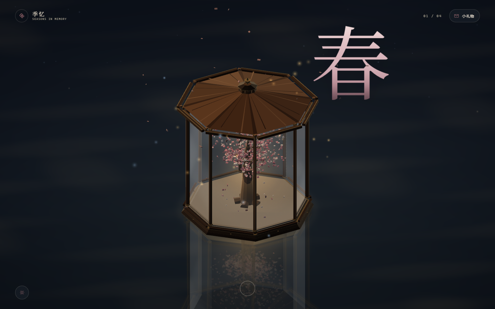
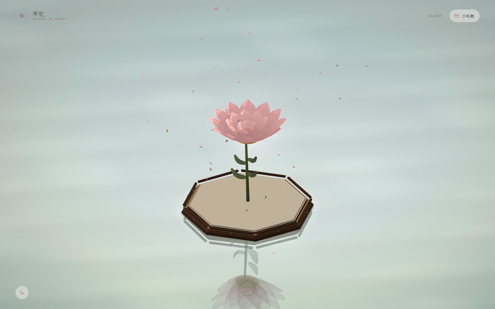

# 季忆 · Seasons in Memory

一盏漂在水上的八角灯笼。转动它，树会走完春、夏、秋、冬；每到一个季节，灯笼会轻轻往下一沉、碰到水面，涟漪从浮板边荡开、再慢慢散去。连续转过两圈，整顶玻璃罩（屋顶连同木柱和玻璃）会抬离水面，树开成一朵立体的花；继续转动，花收回、罩子落回，再转两圈又会开花。

水面一直是动的：细小波纹、灯笼和树的倒影，都会随时间轻轻晃。夜里灯笼自己亮起来，周围有萤火，没有月亮。

主页面现在**只有场景**：没有左下角文字栏。季节落定后，底部正中会出现一个空心圆点，点进去才是这一季的信页 (`letter.html?season=...`)。


<table>
  <tr>
    <td width="50%"></td>
    <td width="50%"></td>
  </tr>
  <tr>
    <td align="center">季节落定 · 灯笼下沉，涟漪从浮板边荡开</td>
    <td align="center">夜间 · 灯笼内部亮起，周围是萤火</td>
  </tr>
  <tr>
    <td></td>
    <td></td>
  </tr>
  <tr>
    <td align="center">每两圈 · 玻璃罩整体移开，树开花</td>
    <td align="center">手机版 · 灯笼、倒影、空心圆点</td>
  </tr>
</table>

## 打开方式

直接双击 `index.html` 即可。没有构建步骤、没有第三方依赖、没有网络请求；灯罩、水面、树和花都是运行时用代码画的，字形使用项目内的 7 kB 字体子集。

- 需要支持 WebGL2 的浏览器：Chrome / Edge / Safari 15+ / 微信内置浏览器（较新机型）。
- 如果在 `file://` 下指针事件受限，可以起一个静态服务器：

```powershell
python -m http.server 8080
npx serve .
```

然后访问 `http://localhost:8080/four-seasons/`。

## 发布到 GitHub Pages（分享到微信）

这个目录已经按 GitHub Pages 的结构准备好：`index.html` 在根目录，`.github/workflows/deploy.yml` 会在 push 到 `main` 时自动部署。

1. 在 GitHub 新建一个仓库（例如 `jiyi`），**把这个目录里的内容上传到仓库根目录**（不是把 `four-seasons` 文件夹整个套进去）。也可以用命令行：

```bash
cd four-seasons
git init
git add .
git commit -m "季忆 · 水上灯笼"
git branch -M main
git remote add origin https://github.com/<你的用户名>/<仓库名>.git
git push -u origin main
```

> 没有装 Git 也可以：在仓库页面点 **Add file → Upload files**，把 `index.html`、`letter.html`、`assets/`、`docs/` 一起拖进去，提交到 `main`。

2. 打开仓库的 **Settings → Pages**：
   - 用附带的 Actions 工作流：**Build and deployment → Source** 选 **GitHub Actions**，以后每次 push 自动发布；
   - 或者不用 Actions：Source 选 **Deploy from a branch**，分支选 `main`、目录选 `/ (root)`。两种都可以（`.nojekyll` 已经放好）。
3. 等发布完成，访问 `https://<你的用户名>.github.io/<仓库名>/`。
4. 微信里打开这个网址 → 右上角 `...` → **分享给朋友**；也可以直接把链接发到聊天里。

**让微信链接卡片有封面图**：部署后把 `index.html` 头部 `<meta property="og:image">` 和 `twitter:image` 里的相对路径改成完整的线上地址，例如：

```html
<meta property="og:image" content="https://<你的用户名>.github.io/<仓库名>/docs/share.jpg" />
```

微信抓取链接时会读取页面标题、`description` 和这张封面图（`docs/share.jpg` 是 1200×630 的分享版）。仓库必须是 **Public**，分享出去才能被打开。

## 交互

| 操作 | 效果 |
| --- | --- |
| 左右拖动 / 横向滚轮 | 旋转灯笼和树，四季连续过渡 |
| 松手 | 惯性滑行后吸附到最近的季节；灯笼下沉、碰水、涟漪荡开 |
| 点击底部正中的空心圆点 | 先扩散三层涟漪，再跳转 `letter.html?season=...`（信页，按需填内容） |
| 左下角月亮 / 太阳图标 | 切换白天 / 夜晚（也可按 `N`），图标交叉淡入旋转 |
| `←` / `→` | 转到上 / 下一个季节 |
| `G` | 打开小礼物 |
| `Esc` | 关闭礼物 |

- **底部只有一个空心圆点**：没有文字，固定在屏幕下方正中；手机和桌面都贴底。它只在季节落定时出现。
- **主页面没有文字栏**：文字只在跳转后的信页里；桌面和手机都留出整块画面给灯笼、水面和倒影。
- **无操作 3 秒**，圆点上方会浮出一行灰字「左右旋转」；任何拖动、滚轮、按键都会让它消失，安静下来 3 秒后再出现。
- **季节落定的下沉**不会锁住操作：出现圆点时仍可以直接拖动，字会淡出、季节继续，灯笼从水里升起。
- 四种季节都停过一次后，右上角的「小礼物」会解锁。

## 场景与字形

- **灯笼盒子**：八边形灯身，深色木柱、上下木圈、八片高透明度玻璃；屋顶是八角木顶，带凸起的八条脊线、木纹条、外挑的檐口与黄铜包边，顶上是小木鼓座和黄铜顶珠。整顶罩子（屋顶 + 木柱 + 玻璃）在开花时一起抬离水面，花开完再落回。
- **更大的灯笼**：灯身比上一版放大约 15%，玻璃到顶留出空间，树冠离玻璃和屋顶都有余量；桌面和手机都能看到树的完整轮廓（约 90% 以上不被结构遮住）。
- **水面**：灯笼浮在木质浮板上，轻微上下浮动；每次季节落定会往下沉一下，接触水面时涟漪从浮板边扩散，随后**逐渐变宽、变淡、平滑消失**；细小波纹一直在动，倒影也会随波扭动。
- **花**：每两圈开一次（`?turns` 只用于调试）。开花时没有大「花」字；树会淡出，花从浮板上长出一根细的绿色花茎，带四片叶子和 27 片曲面花瓣；花比上一版略小。继续转动，花收回、树恢复，再两圈再开。
- **夜间**：没有左上角光源；灯笼内部变亮，成为唯一主光；水面上有暖色倒影，四周有萤火和少量星点。
- **字体**：`季忆`、`春夏秋冬`、`小礼物`、`左右旋转` 全部使用项目内的 **Jiyi Serif**（Noto Serif SC 的 14 字子集，约 7 kB）。手机和电脑加载的是同一份字形，不再依赖系统宋体/黑体；子集之外的汉字回退到系统衬线体。季节大字仍是同色系三段渐变、底部渐隐，透明像素不写深度，不会有方块。

## 文件

```
four-seasons/
├─ index.html              主页面（场景、季节字、空心圆点）
├─ letter.html             季节信页（接收 ?season=spring|summer|autumn|winter|bloom）
├─ assets/
│  ├─ css/style.css        版式、圆点、灰字提示、夜间主题、图标按钮
│  ├─ fonts/
│  │  ├─ jiyi-serif.woff2  14 字内嵌子集
│  │  └─ README.txt        来源、许可证、重新生成命令
│  └─ js/
│     ├─ math.js           矩阵 / 颜色 / 缓动
│     ├─ gl.js             极简 WebGL2 渲染器（水面、倒影、玻璃、字形）
│     ├─ world.js          八角灯笼、浮板、树、3D 花、水面、倒影、涟漪、色板
│     └─ app.js            状态机、拖拽、吸附、下沉、涟漪、开花、夜间、提示
├─ docs/                   预览图与微信分享封面
├─ .github/workflows/deploy.yml
├─ .nojekyll
├─ .gitignore
└─ README.md
```

## 想改的地方

- **四段对话 / 开花时的三句话**：`assets/js/app.js` 顶部的 `SEASONS` 与 `BLOOM_LINES`。主页面已不显示信卡，这些文字可以用在 `letter.html` 里。
- **字体**：`assets/fonts/jiyi-serif.woff2` 与 `style.css` 的 `@font-face`。要加字时按 `assets/fonts/README.txt` 里的命令重新子集化；子集之外的汉字会自动回退。
- **季节色**：`world.js` 顶部的 `PALETTE_SRC`；`leaf` 是叶子色阶，`accent` / `accentDeep` 是界面和季节字，`petal` / `petalCenter` 是花。
- **灯笼和屋顶**：`world.js` 的 `buildRaft()`、`buildCover()`、`buildCaseGlass()`；灯身半径、屋顶高度、木色 `WOOD_*` 都在这里。屋顶的脊线/木纹在 `addRoofStrip` 调用附近。
- **花**：`drawFlower()` 的 `fs`（整体大小，默认 0.86）、`centerY`、`baseY`、花茎和叶子；树干的淡出在 `draw()` 的 `treeFade`。
- **开花的圈数**：`state.nextBloomAt` 初始为 2，开花后设为 `turns + 2`。
- **水色和涟漪**：`draw()` 的 `wShallow` / `wDeep`；`gl.js` 的 `WATER_FS` 控制水波、涟漪速度、宽度和淡出。
- **镜头和字的排布**：`app.js` 的 `computeCamera()`；`camera.target`、`halfH`、`camera.text`。
- **空心圆点、灰字提示、图标按钮**：`index.html` 底部和 `.css` 的 `.hold` / `.ripple-core` / `.hint` / `.night-btn`。
- **小礼物**：`index.html` 的 `.gift-card` / `.gift-art` 和 `app.js` 的 `openGift()`。
- **每一季的信页**：`letter.html` 接收 `?season=spring|summer|autumn|winter|bloom`，可以在这里放照片、长信或礼物。

## 调试参数

| 参数 | 说明 |
| --- | --- |
| `?season=0..3` | 直接停在某个季节 |
| `?angle=45` | 直接转到某个角度（度） |
| `?hold=1` | 强制显示当前季节的定格和圆点 |
| `?bloom=1` | 强制开花（玻璃罩整体移开） |
| `?turns=2.2` | 设置累计圈数（测试两圈开花） |
| `?night=1` | 直接进入夜间模式 |
| `?gift=1` | 打开小礼物 |
| `?static=1` | 关闭 CSS 过渡和动画，便于截图 |
| `?debug=1` | 显示调试浮层，并把内部状态挂到 `window.__jiyi` |

示例：`index.html?angle=180&bloom=1&night=1&static=1`。

## 已验证

- 主页面信卡已隐藏：桌面/手机信卡尺寸均为 `0×0`，画面只保留灯笼、季节字、圆点、提示和拖动。
- 手机 390×844：礼物、昼夜按钮、圆点、提示互不重叠；圆点在下方正中，提示在它上方，夜间按钮在左下。
- 内嵌字体：`document.fonts.check('400 430px "Jiyi Serif"') === true`；桌面与手机的 `季忆`、`春夏秋冬` 使用同一份 Noto Serif SC 子集。
- 灯笼尺寸/屋顶细节：八脊、木纹、檐口黄铜边、鼓座和顶珠都在；树冠与玻璃、屋顶之间留出余量。
- 开花：每两圈一次；开花时没有大「花」字；树干淡出，绿色花茎从浮板长出，花略小；罩子完全移出画面。
- 水面：`waterTime` 持续递增；同一静止定格下相隔 1.6 秒的两帧水面像素不同，波纹/倒影一直在动。
- 下沉：`dip=-0.268`、涟漪年龄 0.65 时截到清晰的一圈水波；涟漪在 4.5–6.3 秒之间平滑淡出，下沉用 `sin²` 包络回到原位。
- 点击圆点 → 3 层涟漪 → `letter.html?season=spring`；无运行时报错。
- 桌面 1440×900、手机 390×844 均检查过；`python -m http.server` 下相对路径和字体文件正常加载（GitHub Pages 同理）。

## 说明

- 页面没有网络请求；`docs/` 只是 README 预览图，不参与页面加载。
- 字体：Noto Serif SC 子集，SIL Open Font License 1.1；详见 `assets/fonts/README.txt`。
- 支持 `prefers-reduced-motion`。
- 主要动效都是阻尼过渡：玻璃罩抬升、花瓣打开、灯笼下沉、涟漪淡出、树淡出都带错峰。
- 本目录已初始化 Git（`main` 分支）。要发布到 GitHub 还需添加远程仓库并 push，或在 GitHub 网页上传；之后按上面的 Pages 步骤发布。
