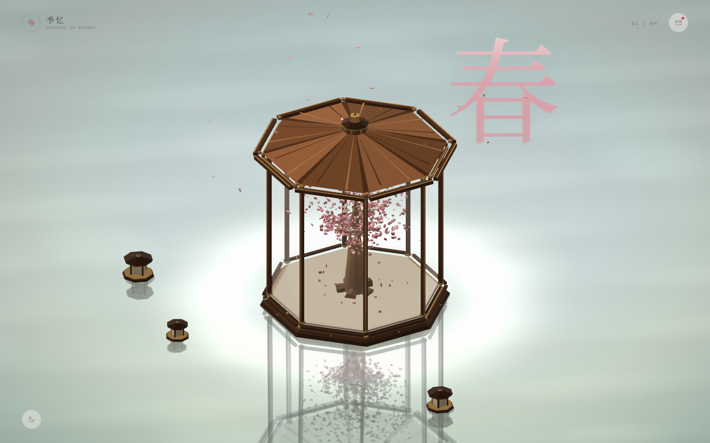

# 季忆 · Seasons in Memory

一盏漂在水上的八角灯笼。转动它，树会走完春、夏、秋、冬；每到一个季节，灯笼会轻轻往下一沉、刚好碰到水面，涟漪从浮板边荡开，再慢慢变宽、变淡、散掉。连续转过两圈，整顶玻璃罩会抬离水面，树开成一朵立体的花；继续转动，花收回、罩子落回，再转两圈又会开花。

水面一直有细小波纹，灯笼、树、花和三盏小水灯都有倒影；夜里灯笼自己亮起来，周围有萤火，没有月亮。

主页面只有场景，没有左下角文字栏。季节落定后底部正中会出现空心圆点；点进去才是这一季的信页 (`letter.html?season=...`)。


<table>
  <tr>
    <td width="50%"></td>
    <td width="50%"></td>
  </tr>
  <tr>
    <td align="center">季节落定 · 灯笼碰水，涟漪慢慢散掉</td>
    <td align="center">夜间 · 灯笼和小水灯一起亮起</td>
  </tr>
  <tr>
    <td></td>
    <td></td>
  </tr>
  <tr>
    <td align="center">每两圈 · 罩子移开，树开花；圆点变成空心花</td>
    <td align="center">手机版 · 灯笼、水灯、倒影和空心圆点</td>
  </tr>
</table>

## 打开方式

直接双击 `index.html` 即可。没有构建步骤、没有第三方依赖、没有网络请求；灯罩、水面、树和花都是运行时用代码画的，字形使用项目内的 84 kB 字体子集。

- 需要支持 WebGL2 的浏览器：Chrome / Edge / Safari 15+ / 微信内置浏览器（较新机型）。
- 如果在 `file://` 下指针事件受限，可以起一个静态服务器：

```powershell
python -m http.server 8080
npx serve .
```

然后访问 `http://localhost:8080/four-seasons/`。

## 发布到 GitHub Pages（分享到微信）

这个目录已经按 GitHub Pages 的结构准备好：`index.html` 在根目录，`.github/workflows/deploy.yml` 会在 push 到 `main` 时自动部署。

1. 在 GitHub 新建一个仓库（例如 `jiyi`），**把这个目录里的内容上传到仓库根目录**（不是把 `four-seasons` 文件夹整个套进去）。也可以用命令行：

```bash
cd four-seasons
git init
git add .
git commit -m "季忆 · 水上灯笼"
git branch -M main
git remote add origin https://github.com/<你的用户名>/<仓库名>.git
git push -u origin main
```

> 没有装 Git 也可以：在仓库页面点 **Add file → Upload files**，把 `index.html`、`letter.html`、`assets/`、`docs/` 一起拖进去，提交到 `main`。

2. 打开仓库的 **Settings → Pages**：
   - 用附带的 Actions 工作流：**Build and deployment → Source** 选 **GitHub Actions**，以后每次 push 自动发布；
   - 或者不用 Actions：Source 选 **Deploy from a branch**，分支选 `main`、目录选 `/ (root)`。两种都可以（`.nojekyll` 已经放好）。
3. 等发布完成，访问 `https://<你的用户名>.github.io/<仓库名>/`。
4. 微信里打开这个网址 → 右上角 `...` → **分享给朋友**；也可以直接把链接发到聊天里。

**让微信链接卡片有封面图**：部署后把 `index.html` 头部 `<meta property="og:image">` 和 `twitter:image` 里的相对路径改成完整的线上地址，例如：

```html
<meta property="og:image" content="https://<你的用户名>.github.io/<仓库名>/docs/share.jpg" />
```

微信抓取链接时会读取页面标题、`description` 和这张封面图（`docs/share.jpg` 是 1200×630 的分享版）。仓库必须是 **Public**，分享出去才能被打开。

## 交互

| 操作 | 效果 |
| --- | --- |
| 左右拖动 / 横向滚轮 | 旋转灯笼和树，四季连续过渡 |
| 松手 | 惯性滑行后吸附到最近的季节；灯笼下沉碰水，涟漪散开 |
| 点击底部正中的空心圆点 | 先扩散三层涟漪，再跳转 `letter.html?season=...`；开花时这是空心花图标 |
| 左上角月亮 / 太阳图标 | 切换白天 / 夜晚（也可按 `N`），图标交叉淡入旋转 |
| `←` / `→` | 转到上 / 下一个季节 |
| `G` | 打开小礼物 |
| `Esc` | 关闭礼物 |

- **底部圆点往上提过**，固定在下方正中，不贴屏幕底；手机和桌面都留出呼吸空间。只有季节落定时出现。
- **开花时圆点变成空心花**，仍然是线稿、无填充；点击照样进入这一季的信页。
- **右上角只有礼物图标**，没有“小礼物”文字；第一次开花后，图标右上角才出现红点。
- **无操作 3 秒**，圆点上方浮出灰字「左右旋转」；任何拖动、滚轮、按键都会让它消失，安静下来 3 秒后再出现。
- **季节落定的下沉**不会锁住操作：出现圆点时仍可直接拖动，季节继续，灯笼从水里升起。
- 主页面没有信卡；点圆点进入 `letter.html` 查看这一季的信。

## 场景与字形

- **灯笼盒子**：八边形灯身，深色木柱、上下木圈、八片高透明度玻璃；屋顶是八角木顶，带八条凸起脊线、木纹条、外挑檐口、黄铜包边、檐角小翘头、木鼓座和黄铜顶珠。整顶罩子（屋顶 + 木柱 + 玻璃）在开花时一起抬离水面，花开完再落回。灯身比上一版放大约 15%，树冠离玻璃和屋顶都有余量。
- **水面小灯笼**：三盏小水灯漂在灯笼周围（左后、左前、右下），带木座、纸罩和小屋顶；白天是暖纸色，夜里纸罩发光，水面有低透明度倒影。数量不多，用来把水面填得有一点生气。
- **水面与倒影**：灯笼浮在浮板上，浮板底离水面约 0.1；季节落定时下沉约 0.1，**刚好接触水面**（不会没入水里），随后涟漪从浮板边扩散。涟漪有独立的生命周期，会持续约 7 秒：先扩散、再变宽、减速，最后平滑淡出，不会突然消失。细小波纹和倒影一直在动。
- **花**：每两圈开一次（`?turns` 只用于调试）。开花动画比上一版更长；没有大「花」字；树会淡出，花从浮板上长出一根细的绿色花茎，带四片叶子和 27 片曲面花瓣；花比上一版略小。继续转动，花收回、树恢复，再两圈再开。
- **季节字**：从亭子里往上升起（约 2.2 个世界单位），透明度从 0 渐到接近 1，再在退出时淡回。白天用更干净的季节色（不再混深色），阴影压到约 0.035，避免和浅色背景混在一起显脏；夜里字和背景保持柔和对比。
- **夜间**：没有左上角光源；灯笼内部变亮，成为唯一主光；水面上有暖色倒影，四周有萤火和少量星点。
- **字体**：页面里的中文（`季忆`、`春夏秋冬`、`小礼物`、`左右旋转`，以及礼物弹层和信页里的文字）全部使用项目内的 **Jiyi Serif**（Noto Serif SC 子集，当前 250 个字符，约 84 kB）。手机和电脑加载同一份字形；新增文字时按 `assets/fonts/README.txt` 重新生成。

## 文件

```
four-seasons/
├─ index.html              主页面（场景、季节字、空心圆点、礼物图标）
├─ letter.html             季节信页（接收 ?season=spring|summer|autumn|winter|bloom）
├─ assets/
│  ├─ css/style.css        版式、圆点、花图标、灰字提示、夜间主题、礼物红点
│  ├─ fonts/
│  │  ├─ jiyi-serif.woff2  页面中文子集（250 字符）
│  │  ├─ page-chars.txt    子集字符清单
│  │  └─ README.txt        来源、许可证、重新生成命令
│  └─ js/
│     ├─ math.js           矩阵 / 颜色 / 缓动
│     ├─ gl.js             极简 WebGL2 渲染器（水面、倒影、涟漪、玻璃、字形）
│     ├─ world.js          八角灯笼、浮板、小水灯、树、3D 花、水面、倒影、色板
│     └─ app.js            状态机、拖拽、吸附、下沉、涟漪、开花、夜间、提示
├─ docs/                   预览图与微信分享封面
├─ .github/workflows/deploy.yml
├─ .nojekyll
├─ .gitignore
└─ README.md
```

## 想改的地方

- **四段对话 / 开花时的三句话**：`assets/js/app.js` 顶部的 `SEASONS` 与 `BLOOM_LINES`；主页面已不显示信卡，这些文字可以放到 `letter.html` 里。
- **字体**：`assets/fonts/jiyi-serif.woff2` 与 `style.css` 的 `@font-face`。加字时把字符加入 `assets/fonts/page-chars.txt`，再按 `assets/fonts/README.txt` 重新子集化。
- **季节色**：`world.js` 顶部的 `PALETTE_SRC`；`leaf` 是叶子色阶，`accent` / `accentDeep` 是界面和季节字，`petal` / `petalCenter` 是花。
- **灯笼和屋顶**：`world.js` 的 `buildRaft()`、`buildCover()`、`buildCaseGlass()`；灯身半径、屋顶高度、木色 `WOOD_*` 都在这里。
- **小水灯**：`buildSmallLanternFrame()` / `buildSmallLanternPaper()`；三盏灯的位置在 `smalls` 数组，数量、间距、大小都在那里。
- **花和花茎**：`drawFlower()` 的 `fs`（默认 0.86）、`centerY`、`baseY`；树干的淡出在 `draw()` 的 `treeFade`。
- **开花圈数**：`state.nextBloomAt` 初始为 2，开花后设为 `turns + 2`。
- **下沉与涟漪**：`app.js` 的 `dip` / `ringAge`（涟漪独立存活约 7.4 秒）；`gl.js` 的 `WATER_FS` 控制水波、扩散速度、宽度和 3.6–6.9 秒的淡出。
- **季节字上升**：`world.js` 里 `rise = ... * 2.2`；`app.js` 的 `textAlpha` 阻尼（3.6）决定升起/淡入速度。
- **圆点、提示、礼物图标**：`index.html` 底部、`style.css` 的 `.hold` / `.ripple-core` / `.flower-icon` / `.hint` / `.gift-btn` / `.gift-dot`。
- **每一季的信页**：`letter.html` 接收 `?season=...`，可以放照片、长信或礼物。

## 调试参数

| 参数 | 说明 |
| --- | --- |
| `?season=0..3` | 直接停在某个季节 |
| `?angle=45` | 直接转到某个角度（度） |
| `?hold=1` | 强制显示当前季节的定格和圆点 |
| `?bloom=1` | 强制开花（玻璃罩整体移开） |
| `?turns=2.2` | 设置累计圈数（测试两圈开花） |
| `?night=1` | 直接进入夜间模式 |
| `?gift=1` | 打开小礼物 |
| `?static=1` | 关闭 CSS 过渡和动画，便于截图 |
| `?debug=1` | 显示调试浮层，并把内部状态挂到 `window.__jiyi` |

示例：`index.html?angle=180&bloom=1&night=1&static=1`。

## 已验证

- **涟漪不再戛然而止**：应用层现在持续传入约 7.4 秒的涟漪年龄；实测 `rippleAge` 在 0.58 / 2.63 / 4.78 / 6.58 秒时都还在，水环继续变宽、变淡，3.6–6.9 秒之间平滑归零。
- **下沉只碰水**：`dip` 最大约 −0.096，浮板底最低约 0.008，不再没入水面；涟漪从浮板边起。
- **圆点上移**：桌面 bottom 约 68px，手机约 44px；手机实测圆点 `[175,756,40,40]`，提示 `[172,727,45,13]`，昼夜按钮 `[16,796,36,36]`，礼物 `[332,17,40,40]`，信卡 `0×0`，互不重叠。
- **开花圆点**：`hold is-on is-bloom`，花生图标 opacity 1；礼物按钮 `gift-btn is-ready`，红点出现。
- **小水灯**：3 盏，白天纸罩暖色，夜里发光，水面有倒影。
- **季节字上升**：从亭子内部向上约 2.2 单位，透明度 0 → 0.98；白天阴影压到 0.035，字色不再混入深色。
- **字体**：`document.fonts.check('400 430px "Jiyi Serif"') === true`；页面 250 个中文使用同一份 Noto Serif SC 子集。
- **开花**：每两圈一次；没有大「花」字；树干淡出、绿色花茎、花略小；罩子完全移出。
- 桌面 1440×900、手机 390×844 检查过；无运行时报错；本地 HTTP 下页面、信页、字体、CSS 均 200。

## 说明

- 页面没有网络请求；`docs/` 只是 README 预览图，不参与页面加载。
- 字体：Noto Serif SC 子集，SIL Open Font License 1.1；详见 `assets/fonts/README.txt`。
- 支持 `prefers-reduced-motion`。
- 本目录已初始化 Git（`main` 分支）。要发布到 GitHub 还需添加远程仓库并 push，或在 GitHub 网页上传；之后按上面的 Pages 步骤发布。
